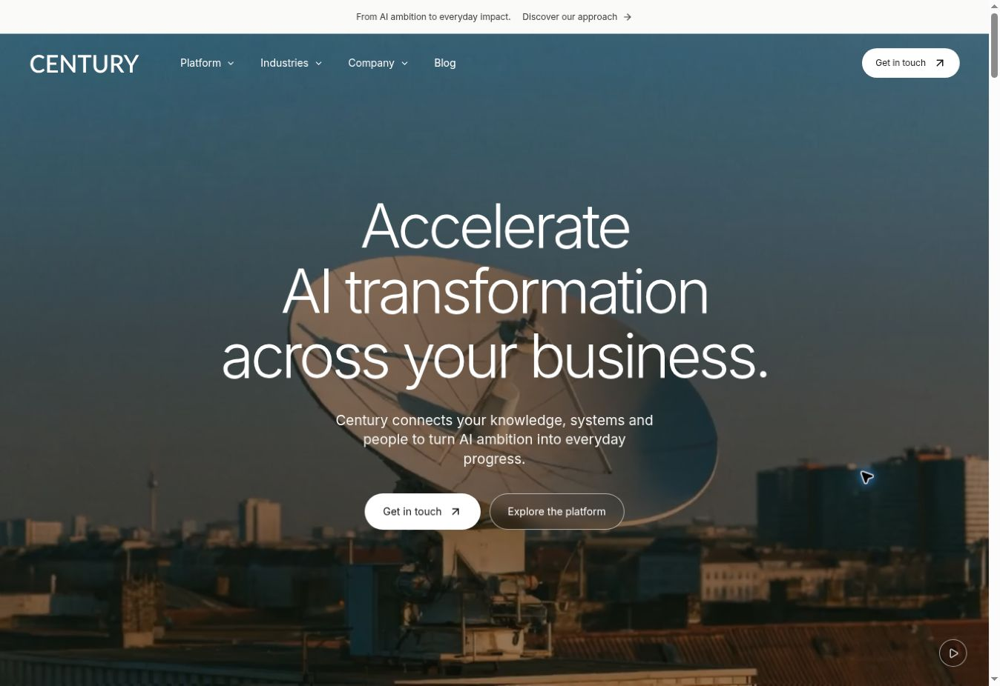

# Century — Wonderful design migration

## Goal and fixed requirements

Move the existing Century website towards the current visual language and product narrative of https://www.wonderful.ai/, preserving Century, its three founders, their photographs, roles and verified contact destinations. Use the two Century SVG wordmarks supplied for this task. Complete the work in small stages, validate it, merge to `main`, and verify the existing GitHub Pages deployment.

Baseline: `952d1562140eb9b5a93a7cd425c9cd2822b88d99` on `main`. Working branch: `design/wonderful-century-2026-11-04`.

## Reference audit — 4 November 2026

The current reference presents an enterprise AI operating layer, agents, systems, AI gateway, deployment and strategy. Its visual system uses full-bleed moving imagery, white and near-black sections, large light headings, restrained borders, round buttons and photographic editorial cards. The old Century purple and lavender treatment does not match this direction.

Observed reference typography: ABC Favorit Light for headings; Inter for body and buttons. Use Inter locally for the new Century system rather than introducing an unlicensed commercial font dependency. Keep text, layouts and code maintainable in the existing Next.js project.

Preserve the existing 26-route structure and functioning product examples. Adapt reference ideas into original Century copy. Wonderful's customer relationships, funding, certifications and performance figures do not establish equivalent facts about Century and are not transferred. Reference media used as design assets must be served locally and documented below.

## Small stages

- [x] Audit source, route inventory, reference design and existing deployment.
- [x] Create this progress file and isolated working branch.
- [x] Apply supplied wordmarks and shared typography, colours, navigation and footer.
- [x] Recompose the homepage: cinematic hero, use cases, platform, deployment, strategy, industries and founders.
- [x] Carry the design through product, industry and company pages.
- [x] Refresh metadata, social preview, press resources and project documentation.
- [x] Build and inspect the static export; review responsive source and check key interactions in the live desktop browser.
- [x] Review the diff, publish the branch, merge to `main`, verify deployment and capture the result.

## Validation record

- `npm run typecheck`: passed.
- Local preview build: all routes generated. The workspace lacks `/proc` RSS metrics, so Next 15.5.28's optional `traceMemoryUsage` diagnostic throws before compilation. Only the ignored local dependency tracer was temporarily changed to skip that exact `ENOENT` diagnostic. No global process API, application source, package lock or deployment workflow is patched. The unmodified production build subsequently passed in GitHub Actions, as recorded below.
- `npm run check:export`: passed for all 26 content routes, unique metadata, 2,302 local links/assets, sitemap, contact destinations and sample labels.
- Local Playwright suite could not reach assertions because Chromium is absent. Its standard browser download returned a truncated archive. The Cloud Browser is separate from the localhost preview server. No automated browser test success is claimed; the separate live-browser checks are recorded below.
- `git diff --check`: passed. The two supplied logo SVGs were verified byte-for-byte unchanged.

## Released and checked — 4 November 2026

- [PR #47](https://github.com/STACKLEVEL-AI/century-ai-next/pull/47) merged into `main` as [`1163e7c32c64efe17043ec8e85a60a6c60adf502`](https://github.com/STACKLEVEL-AI/century-ai-next/commit/1163e7c32c64efe17043ec8e85a60a6c60adf502).
- The standard, unmodified production build and GitHub Pages deployment both completed successfully in [Actions run 41842820065](https://github.com/STACKLEVEL-AI/century-ai-next/actions/runs/41842820065), for that exact merge commit.
- The new release was verified at [https://century-ai.eu/](https://century-ai.eu/) after deployment. The following checks used the live site in a desktop browser, not the local preview.

| Live check | Observed result |
| --- | --- |
| Homepage visuals and film | Supplied white wordmark, Inter typography, new photographic design and local film rendered. Video reached ready state 4 without a media error; playback and pause worked. |
| Shared header | Platform menu expanded and its AI OS link navigated successfully. Scrolled header changed to the light surface and black wordmark. |
| AI OS | Dark photographic hero rendered. Clicking Observability changed the panel; ArrowRight selected Workflows and displayed the matching content. |
| Gateway | Selecting 7d changed the example values and period label. Control examples displayed its matching panel. CSV link declared `century-sample-usage-7d.csv`; a file download was not executed in this manual check. |
| Industry selector | Selecting Retail changed the selected state, heading, description and destination link. |
| Founders and contact | Vitali Bakhmat, Vadim Vladymtsev and Egor Krychev retained their names, roles and loaded portraits. The Contact page rendered and its main action retained `https://t.me/vitalibakhmat`. |
| Desktop layout and errors | At a 1363 px browser width, the homepage document width was 1348 px, with no horizontal overflow. No site errors were present in the captured browser error log; extension-only messages were excluded. |

Responsive breakpoints were reviewed in source, including the repaired 760–900 px navigation range. A rendered mobile-viewport check, automated Playwright assertions, reduced-motion emulation and a manual visit to every route were not completed in this environment. Static export inspection covered all 26 content routes.

Release screenshots: [homepage](previews/century-home-live-2026-11-04.jpg) and [AI OS](previews/century-ai-os-live-2026-11-04.jpg).

## Asset provenance

- Century black and white wordmarks: SVG files attached by the user in this task.
- Founder portraits and profile URLs: preserved from the baseline repository.
- Reference film: https://cdn.wonderful.ai/videos/HP%20-%20Video_Final_16x9.mp4. `public/media/enterprise-film.mp4` is a locally re-encoded 13-second selection (0–5, 24–28, 40–44 seconds) at 1280 px / 24 fps, without audio. The selection avoids the visible customer-bank signage in the original. Hero poster and knowledge/workflow/support card stills are extracted from this film.
- Deployment photograph: https://framerusercontent.com/images/GE2ff9hpxjunCs3VZvJODYW4IoQ.jpg → `public/media/deployment.webp`.
- Strategy image: https://framerusercontent.com/images/aa4tkKpVkqnWNLuv9cZYR9CEP5o.png → `public/media/strategy.webp`.
- Platform background: https://framerusercontent.com/images/PbxeRt98ocw3ESBEOGvSkFl16OM.jpg → `public/media/platform.webp`.
- Industry image: https://framerusercontent.com/images/Z6ITE2va5GBIFUhQaiHnfePJmaY.jpg → `public/media/industry.webp`.
- Closing image: https://framerusercontent.com/images/z2gffofvCT8lr3s0y08hDCe9MZ4.jpg → `public/media/closing.webp`.
- These publicly delivered reference assets are used for the requested design migration. They are illustrative media, not photographs of Century's premises or evidence of Century customer relationships. All files are served locally; visitors do not request media from Wonderful.
- Inter is bundled by `next/font`; the reference's commercial ABC Favorit font is not redistributed.

## Checkpoints

1. Source and reference audited; dependencies installed; existing 26 routes and their interactions retained as the baseline.

2. Shared design and homepage implemented; internal product, industry and company styles neutralised. User-provided SVGs are used in the header, footer, press downloads and social preview. The brand monogram is derived from the supplied first glyph.

3. Internal page families, neutral illustrations, About/Contact media, both brand downloads, favicon and social metadata updated. Supplied SVG files verified byte-for-byte identical. CSS compatibility warnings corrected; final preview export rerun before publication.

4. Independent source review found and fixed the 760–900 px mobile menu breakpoint. The full mobile panel structure now applies at 900 px. The header is absolute before JavaScript upgrades it to fixed on scroll, preserving readable top navigation without JavaScript. No further material source-review blockers found.

5. Five staged implementation commits were published through the GitHub connector. PR #47 was merged, the standard Pages workflow succeeded, and the live release was inspected. This final documentation checkpoint records the actual browser checks and preserves screenshots of the published result.
