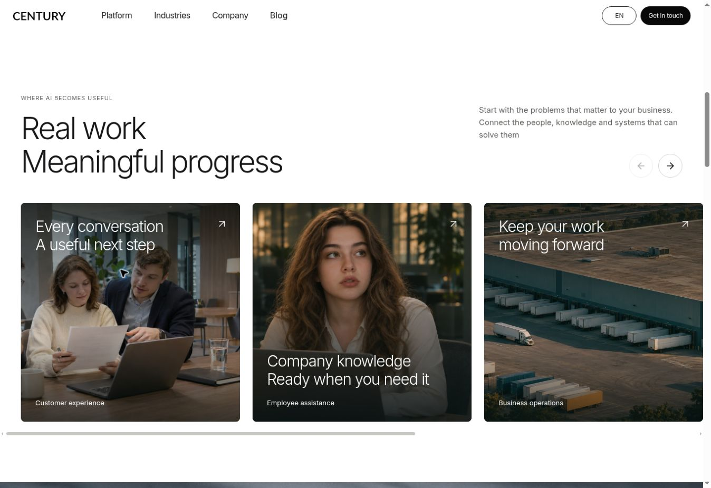

# Display copy punctuation — 6 November 2026

Published in [commit 5dc3b3c](https://github.com/STACKLEVEL-AI/century-ai-next/commit/5dc3b3c31c0b0f765362c33eec4077b34752496f). [GitHub Pages deployment 42122185093](https://github.com/STACKLEVEL-AI/century-ai-next/actions/runs/42122185093) completed successfully.

## Copy style

Headings, slogans, hero leads, short card descriptions, photograph captions, application screenshot captions and closing calls to action now omit terminal full stops. The same rule applies at explicit line breaks within slogans. Paired phrases on one line use a comma when a separator is needed for natural reading.

The source text was updated directly across the homepage, the six Platform routes, seven industry pages, the industry directory, Company pages and guide titles. Five visible text lines in four native SVG diagrams follow the same style. Article prose, editorial paragraphs, legal explanations, FAQ answers and sentence boundaries within multi-sentence descriptions retain ordinary punctuation.

## Integration

The change is based on `53813c33ff3c9f9470d8f9f1a35a569b924945e5`, preserving its per-page photograph assignments, responsive sizes, crop positions and CSS gradients. The final Employee assistance photograph and its caption placement from `a00bbe7578a1b6a6540ae0b89bd691bbbdb966b8` are also preserved.

## Verification

- Type validation and the production build passed locally
- Static export inspection passed for all 26 content routes and 2,592 local links/assets
- All 28 exported HTML files, including error-page outputs, were inspected: 424 headings and 17 figure captions have no terminal full stops, including at explicit line breaks
- All 51 text labels in the six native Century SVG diagrams have no terminal full stops
- Live browser checks passed on the homepage, Agents, Banking and About Century after refreshing previously cached pages
- The five homepage use-case photographs loaded at their expected dimensions; the final portrait uses `/media/employee-assistance-woman.webp?v=51966346`
- The portrait caption sits below the face, ending 64 px above the bottom of the 420 px desktop card
- The inspected desktop pages have a 1,348 px document width matching the viewport content width

The GitHub Pages workflow remains a single deployment job. These local inspections add no CI jobs or test steps. This copy update does not claim a separate mobile-device browser pass.

