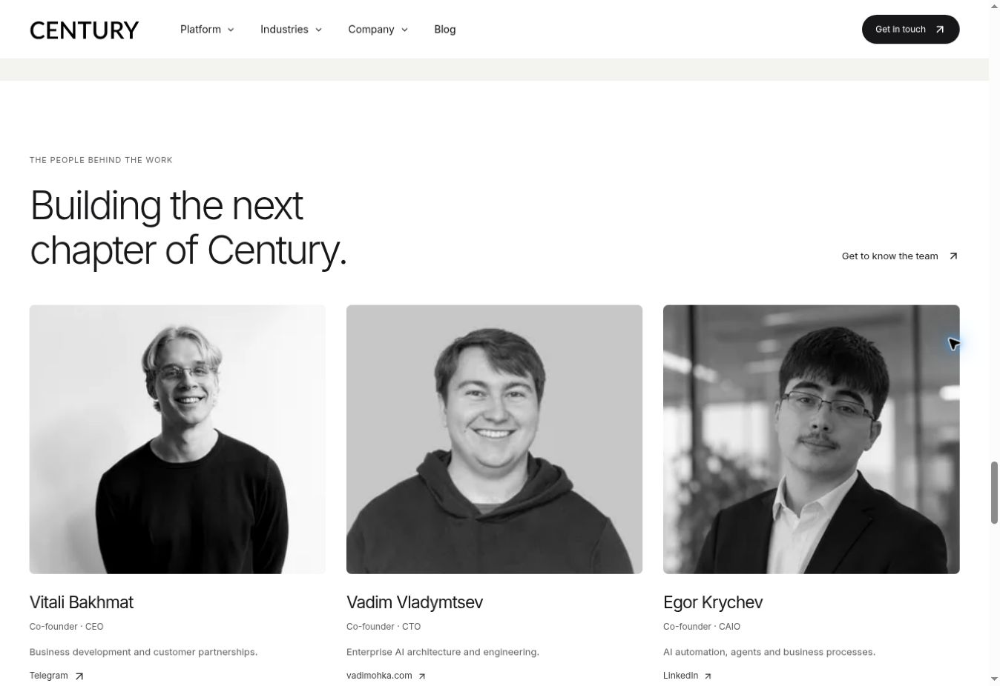

# Photography merge and branch cleanup — 4 November 2026

## Request

Merge the branch containing the updated pictures, keep the existing founder photographs unchanged, verify publication and remove redundant branches.

## Identified branch

- Pull request: [#49](https://github.com/STACKLEVEL-AI/century-ai-next/pull/49).
- Source branch: `feat/generated-photography-2026-11-04`.
- Original source tip: `756d428b9b645b53ff22e9f61f35f33b602d438e`.
- Main before this task: `cad5ff160878585c75ce78a075f06d7b14087a6a`.

The source branch changes ten scene/background photographs, four responsive derivatives, the social preview and the background film. Its three generated founder alternatives are excluded from the merge. The existing founder photographs are restored directly from the baseline main, without resizing or re-encoding.

## Preservation checks

| Preserved photograph | Git blob from baseline main |
| --- | --- |
| `public/founders/vitali-bakhmat.webp` | `9c959204a4765f4c3f1097db54f6b40901614372` |
| `public/founders/vadim-vladymtsev.webp` | `82f83026c5935f134e3ccc748246e65d341c6b6d` |
| `public/founders/egor-krychev.webp` | `33a891712d166322b05b0798600ee8fb5ef21966` |

All three photographs and all six files in `public/media/app/` compare byte-for-byte with baseline main. Founder names, roles, contact destinations and rendering components are unchanged. The 16 updated public media files compare byte-for-byte with the selected source branch. The [asset verification manifest](photography-merge-asset-verification-2026-11-04.json) records the SHA-256 hashes and file sizes for all 25 checked assets.

Current main was merged into the candidate before publication so that the previous application-capture release log and its published-site screenshot remain intact. Documentation distinguishes the excluded founder generations in the historical branch gallery from the photographs actually shipped.

## Validation

- [x] Identify the image branch and review its code and asset changes.
- [x] Preserve the three original portraits and six real application captures exactly.
- [x] Preserve the previous application-capture release documentation.
- [x] TypeScript check passes.
- [x] Build and static export inspection pass for the combined result: 26 content routes and 2,364 local links/assets.
- [x] Merge PR #49 and confirm the production build/deployment.
- [x] Verify the published media and inspect the live page.
- [x] Remove six redundant local branches after confirming their contents are saved.
- [ ] Remove the four merged branches on GitHub; the connector has no branch-deletion operation and the browser requires sign-in.

The preview build used the existing ignored local dependency workaround for unavailable RSS diagnostics, already documented in the earlier release logs. The production workflow is unchanged. No Playwright run or mobile-browser result is claimed for this merge.

## Branch cleanup audit

The remote branches `design/real-century-screenshots-2026-11-04`, `design/wonderful-century-2026-11-04` and `feat/wonderful-design-system` are ancestors of baseline main. The photography branch becomes redundant only after its corrected tip is merged.

Five older local branches can be removed: `design/real-century-screenshots-2026-11-04`, `design/wonderful-century-2026-11-04`, `docs/live-verification-2026-11-04`, `docs/verify-app-captures-2026-11-04` and `release/verified-century-2026-11-04`. Their commits are either ancestors of main or have exact tree equivalents already in main's history. The differing local SHAs were produced when the same changes were transferred through the GitHub API. All eight local-only intermediate trees were checked, not just their branch tips.

The five older local branches above and the completed local photography branch were deleted after the merge. The sole local branch is `main`. The four remote branches were verified as merged, but their deletion still requires GitHub browser access; no remote deletion is claimed at this checkpoint.

## Published result

- [PR #49](https://github.com/STACKLEVEL-AI/century-ai-next/pull/49) merged as `981bc840007c05c404e0daa2a5ea8e4487f0c4c6`; corrected source tip: `e78f6db31045a6d03965bd70c8c6507554ed6aa7`.
- The unmodified production build and deployment [completed successfully in run 41853684192](https://github.com/STACKLEVEL-AI/century-ai-next/actions/runs/41853684192).
- All 25 canonical public asset URLs returned HTTP 200. Each downloaded response matched the expected repository SHA-256: 16 updated assets, three original founder photographs and six original application captures. The manifest contains the per-file URLs, hashes, sizes and response metadata.
- Live desktop review confirmed the new homepage imagery, the 13-second 1280 × 720 background film and its pause control. The founder section displayed the original 320 px-wide files at their expected aspect ratios. No horizontal overflow was observed on the reviewed homepage view.
- Verified public pages: [updated homepage](https://century-ai.eu/#home) and [preserved founders](https://century-ai.eu/#founders).

