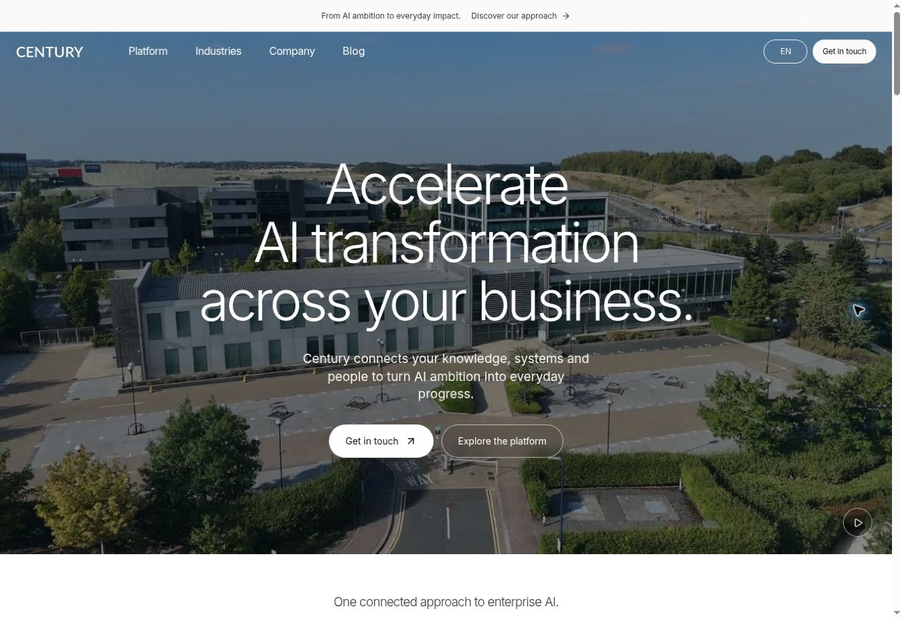
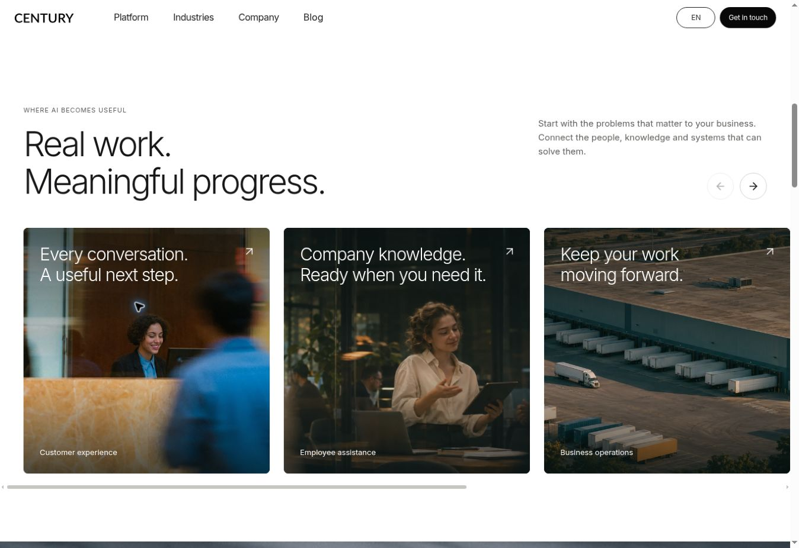

# Licensed stock video and homepage structure — 5 November 2026

The homepage now follows the current Wonderful section sequence with Century content and licensed, locally served stock footage. This update replaces the earlier 13-second generated-photo animation. It builds on the existing 26-route site and the latest navigation work on `main`.

## Homepage composition

The composition below includes the requested 6 November adjustment: restore the earlier industry layout, align the hero to the current header, and remove the separate manifesto statement.

1. Full-width video hero, centred headline and two actions.
2. A capabilities strip occupying the reference's proof-strip position.
3. A horizontal rail of five square use-case cards, with scroll controls and native links.
4. One Century AI OS section with the existing real application captures.
5. Paired Deployment and AI Strategy image cards.
6. The earlier two-column industry section: a vertical list of seven sectors beside a compact dark photographic panel, restored from `ba158e3` with scoped responsive styles.
7. A photographic team section with About Century and Careers cards, plus the three original founder portraits.
8. The shared footer and the existing Telegram contact action.

The hero now fills the available first viewport after the 48 px announcement strip. Its navigation remains an overlay; content padding accounts for the 60 px desktop or 68 px mobile header. Automatic height lets the section grow when a short viewport or larger text requires more room. The current video, posters and native muted autoplay remain unchanged.

The separate home product-family, additional screenshot gallery, large founders grid, guide grid and repeated contact panel have been removed from the homepage composition. Their relevant product, company and editorial pages remain available through navigation. The complete founder profiles remain on `/about-us/`. The homepage keeps `#use-cases`, `#platform`, `#how-we-start` and `#contact`, and now includes `#industries` and `#team`.

Reference customer logos, customer outcomes and filmed testimonials are not evidence about Century, so the corresponding positions use Century capabilities and original copy. The main reference's Utilities customer story and proprietary product demos are not treated as interchangeable stock loops. All 26 existing content routes remain present.

## Film selection

The 24-second film follows a progression from enterprise infrastructure to people and then physical operations. Eight clips, three seconds each:

| Timeline | Subject | Source |
| --- | --- | --- |
| 0–3 s | Office campus | [Pexels 33491568](https://www.pexels.com/video/aerial-view-of-modern-office-buildings-33491568/) |
| 3–6 s | Traffic management control room | [Pexels 38779100](https://www.pexels.com/video/high-tech-traffic-management-control-room-38779100/) |
| 6–9 s | Passenger using a phone in an airport | [Pexels 12903813](https://www.pexels.com/video/woman-sitting-in-airport-terminal-12903813/) |
| 9–12 s | Occupied office windows | [Pexels 9674159](https://www.pexels.com/video/view-from-outside-of-people-working-in-offices-9674159/) |
| 12–15 s | Hands typing | [Pexels 6143901](https://www.pexels.com/video/hands-typing-on-a-keyboard-6143901/) |
| 15–18 s | Screen reflected in glasses | [Mixkit Free 221](https://mixkit.co/free-stock-video/reflection-of-a-screen-in-glasses-221/) |
| 18–21 s | Truck on a forest highway | [Pexels 32044530](https://www.pexels.com/video/aerial-view-of-truck-on-forest-highway-32044530/) |
| 21–24 s | Warehouse and trucks | [Pexels 20654633](https://www.pexels.com/video/an-aerial-view-of-a-large-warehouse-with-trucks-20654633/) |

The chosen licences permit free commercial website use and modification without mandatory attribution: [Pexels License](https://www.pexels.com/legal-pages/license/) and [Mixkit Stock Video Free License](https://mixkit.co/license/modal/videoFree/). Credits and source-specific provenance are retained in [stock-video-licenses.md](stock-video-licenses.md) and [stock-video-manifest.json](stock-video-manifest.json). These scenes illustrate the subject matter; they do not identify Century employees, premises or customer deployments.

## Delivery and accessibility

| Asset | Format | Bytes |
| --- | --- | ---: |
| `enterprise-film.mp4` | 1280 × 720, 24 s, H.264 | 2,080,708 |
| `enterprise-film-mobile.mp4` | 540 × 960, 24 s, H.264 | 1,231,864 |
| `hero-poster.webp` | 1280 × 720 WebP | 166,158 |
| `hero-poster-960.webp` | 960 × 540 WebP | 95,770 |
| `hero-poster-640.webp` | 640 × 360 WebP | 44,076 |
| `hero-poster-mobile.webp` | 540 × 960 WebP | 72,752 |

Both films use H.264/yuv420p, 24 fps, faststart and no audio. Mobile framing is adjusted by subject for each scene; it is not a single centre crop of the completed desktop film. Eight 960 × 540 frame extracts remain in `public/media/stock/`; the 6 November photography update replaced their homepage uses with independent photographs. The posters are the first actual frame of the opening scene. The social image is regenerated from the new poster using the existing wordmark and copy.

`HeroFilm` chooses one media file at mount: mobile at widths up to 640 px, desktop above that. A resize does not download a second film. Reduced motion and Save-Data use the poster, as does a page without JavaScript. A media error restores the poster. The selected film autoplays in a muted inline loop. All files are served from the static export; no visitor request goes to a stock-media provider.

The use-case rail supports touch scrolling, keyboard-accessible links and previous/next controls. The industry tabs retain arrow/Home/End navigation, a single focusable active tab, correct panel labels and seven no-JavaScript fallback links. The restored section uses a distinct local photograph for each industry. It stacks below 900 px, with two columns of choices on tablets and a vertical list below 640 px.

## Homepage photography update — 6 November

The homepage now uses 18 distinct photographs across its logical image slots, including all seven industry tabs and the Company menu press card. Responsive variants of the hero poster and the desktop/mobile renderings of the same navigation card count as one slot each. Four groups of repeated images were removed, and the five use-case cards no longer reuse frames from the opening video.

Existing editorial photographs supply the replacement images. Employee assistance adds one generated environmental workplace scene guided by the user's appearance references and the site's existing photographic style: a close lookalike with small facial differences, candid activity, motion blur and muted warm/teal tones. The generated scene is illustrative; it does not identify a Century employee or customer. The source reference attachments and the two discarded portrait-style candidates are not included in the repository.

The selected new WebP is 1600 × 900 and 64,132 bytes. The complete slot mapping, dimensions, SHA-256 hashes, generation method and final prompt are recorded in [the photography manifest](homepage-photography-2026-11-06.json). The current hero films, founder photographs, application captures, page layout and deploy-only workflow are preserved.

## Maintenance

`npm run assets:film` is an optional maintenance command, never a build/deployment step. It requires FFmpeg and ffprobe, reads the committed source manifest, downloads missing source files into a cache, verifies SHA-256, stages the edited films/posters/frame extracts and checks them before replacing production assets. The manifest includes source URLs, authors, trim points, mobile crop centres and published-file hashes. After regenerating any hero asset, update the version in `src/lib/hero-media.ts` to invalidate returning visitors' cached media. `npm run assets:og` refreshes the local social preview after poster changes.

## Verification before publication

- TypeScript validation completed successfully.
- Next.js production compilation and static export completed successfully for the full route inventory.
- The existing optional export inspection passed: 26 content routes and 2,527 local links/assets, including metadata, contact destinations and the real application screenshots.
- Both MP4 files decoded completely: 576 frames each, no audio tracks, no decode errors and no black-frame gaps. Faststart metadata precedes media data.
- All 12 new WebP files decode and match the dimensions and hashes recorded in the manifest.
- The three original founder portraits and six application captures match the baseline Git blob hashes byte-for-byte.
- The latest upstream navigation changes were integrated before the final local build. Deployment workflow, dependency versions, route registry and contact destinations are unchanged.

The local container uses Node 24 and does not expose `/proc` RSS statistics. The local build used a temporary, uncommitted compatibility preload solely for Next.js memory diagnostics; compilation and type validation remained enabled. The published GitHub Pages build uses the repository's existing Node 20 workflow. Browser publication checks and the Actions run establish the live result separately from these local checks. The optional Playwright suite was updated for the new intentional homepage structure but was not run in this environment.

## Publication and browser verification

Published through GitHub MCP in [implementation commit d831f0a](https://github.com/STACKLEVEL-AI/century-ai-next/commit/d831f0a5685bd53bfc301a6fc352dab2892a636d), followed by [media-cache fix d7d0a67](https://github.com/STACKLEVEL-AI/century-ai-next/commit/d7d0a67ac0f3a3746cd639b7bcb24852c8ae253a). The final [GitHub Pages deployment, run 42107979429](https://github.com/STACKLEVEL-AI/century-ai-next/actions/runs/42107979429), completed successfully.

The live homepage was checked in the browser after deployment. The hero loaded the versioned desktop MP4 with duration 24 seconds, 1280 × 720 dimensions and no media error. Pause worked and remained set after scrolling away. The use-case rail advanced 444 px with the Next control; the industry panel changed to Telecommunications with its correct photograph, and End selected Airlines. The About card opened the existing About page with all three founder profiles. At the inspected desktop viewport, document and viewport widths both measured 1,348 px, with no page-level horizontal overflow.

Both live MP4 responses returned HTTP 200 and matched the committed SHA-256 hashes, including the 1,231,864-byte mobile file. Desktop browser interaction and mobile asset integrity were checked; device-emulated mobile UI testing and the complete optional Playwright suite were not run. Browser-extension log entries were separate from the website.

The first live check revealed a returning browser could reuse the former 13-second film at an unchanged URL. The shared versioned URLs in `hero-media.ts` corrected this; the final browser read confirmed `/media/enterprise-film.mp4?v=7be70f19` and its matching poster.

## Photography publication verification — 6 November

Published in [commit 96a8b44](https://github.com/STACKLEVEL-AI/century-ai-next/commit/96a8b44733d527e74822531b5eacd963ff874ac0); [deployment 42115401520](https://github.com/STACKLEVEL-AI/century-ai-next/actions/runs/42115401520) succeeded. Local type validation, the production build and the optional export inspection passed (26 routes, 2,605 local links/assets). The browser loaded all five use-case photographs and all seven distinct industry-tab photographs at the expected dimensions. The new scene was inspected inside the real card, with the face clear of the headline. No page-level horizontal overflow was present at the inspected desktop viewport.

